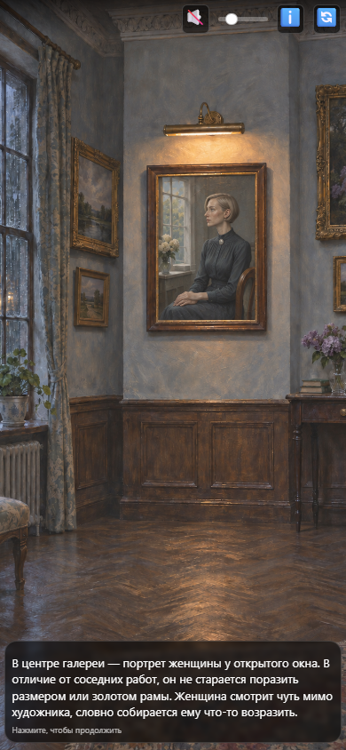

<h1 align="center">Обратная сторона холста</h1>

<em>Камерная детективная визуальная новелла · 12+</em>

  

  <a href="https://github.com/thwkxri/Obratnaya_storona_kholsta/archive/refs/heads/main.zip"><strong>Скачать игру</strong></a>
  · <a href="#как-играть">Как играть</a>

## До открытия дороги

Из домашней галереи исчезает портрет. Дорога закрыта из-за непогоды, и у Ильи есть время осмотреть усадьбу и расспросить её обитателей. В блокноте он собирает то, что увидел, услышал и смог проверить.

Три решения меняют ход расследования. В финале игрок сам выбирает, кого назвать и какие записи предъявить. История может закончиться восемью способами.

## Как играть

Распакуйте архив целиком и откройте `game/index.html` в Microsoft Edge или Google Chrome. Игра работает локально без установки и подключения к интернету. [Скачать ZIP](https://github.com/thwkxri/Obratnaya_storona_kholsta/archive/refs/heads/main.zip)

Нажмите на реплику или используйте Enter и пробел, чтобы продолжить. Прогресс сохраняется в браузере. Кнопка ↻ начинает прохождение заново.

  
  

## Текущая версия

25 ноября 2026 года подключены 75 фоновых иллюстраций. Крупные планы улик показываются отдельным шагом без персонажей. Перед следующей репликой игра возвращает общий план и выводит говорящего.

Проверены все восемь сочетаний маршрутов и все восемь концовок. В Edge также проверены загрузка всех фоновых PNG, выбор аргументов и восстановление автосохранения. После обновления сюжета прохождение прежней версии может начаться заново.

## Авторы и движок

Мария Прохоренко и Дмитрий Сухобаевский.

Новелла работает на движке Ильи Барило. Его условия распространения и сторонние уведомления включены в папку игры. [vn-vertical-engine v0.6.10.1](https://github.com/IlyaBarilo/vn-vertical-engine/releases/tag/v0.6.10.1), [лицензия движка](game/LICENSE), [уведомления](game/NOTICE.md).
