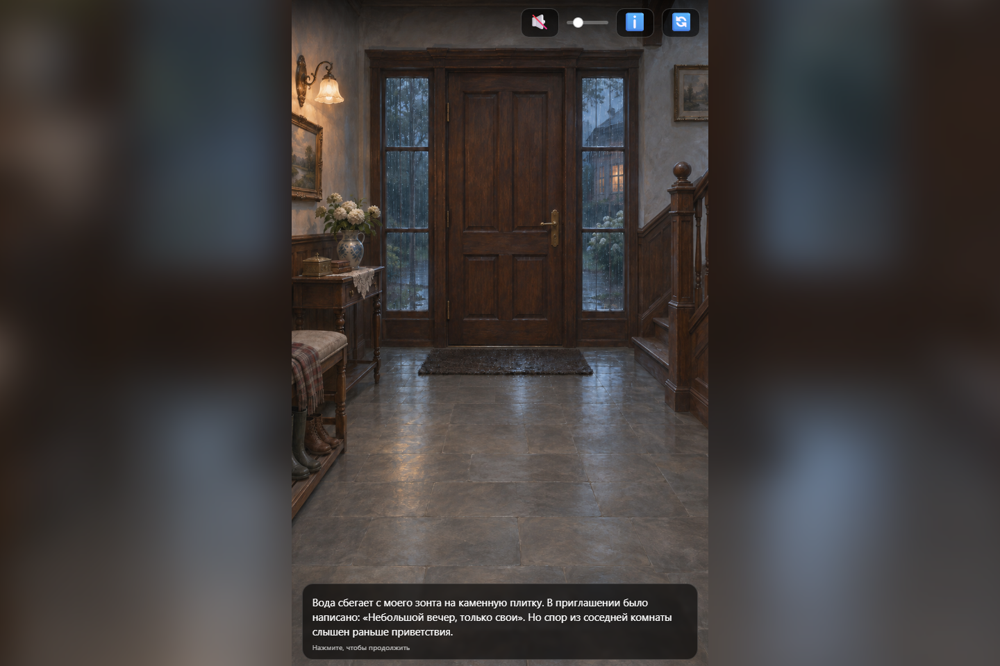
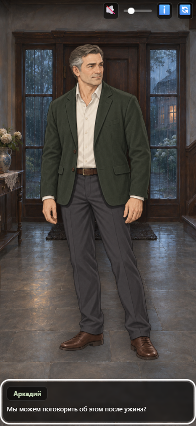

<h1 align="center">Обратная сторона холста</h1>

Детективная визуальная новелла · 12+

  

  <a href="https://github.com/thwkxri/Obratnaya_storona_kholsta/archive/refs/heads/main.zip"><strong>Скачать игру</strong></a>

## О чём игра

Илья приезжает в усадьбу дождливым вечером. В галерее ему показывают портрет женщины у окна. Ночью он слышит шаги и щелчок двери, а утром на месте портрета остаётся светлый прямоугольник. Крепления целы, остальные картины на месте. На подъездную дорогу упало дерево, и пока её расчищают, хозяин просит Илью разобраться, куда делась картина.

В каждом из трёх кругов расследования вы выбираете, какую версию проверить. Можно осмотреть комнаты и вещи, сверить документы или попросить обитателей дома рассказать, где они были ночью. Некоторые разговоры и сцены открываются только после определённых решений. Илья записывает в блокнот то, что успел увидеть, услышать и проверить.

В финале вы можете назвать одного из пятерых подозреваемых, выбрать записи для предъявления и решить, говорить наедине или при всех. Можно и вовсе отказаться от обвинения. Всего в игре восемь концовок.

## Как играть

Распакуйте архив и откройте `game/index.html` в браузере. Чтобы продолжить, нажмите на реплику, Enter или пробел. Прогресс сохраняется автоматически.

  
  

## Авторы

Мария Прохоренко и Дмитрий Сухобаевский.
