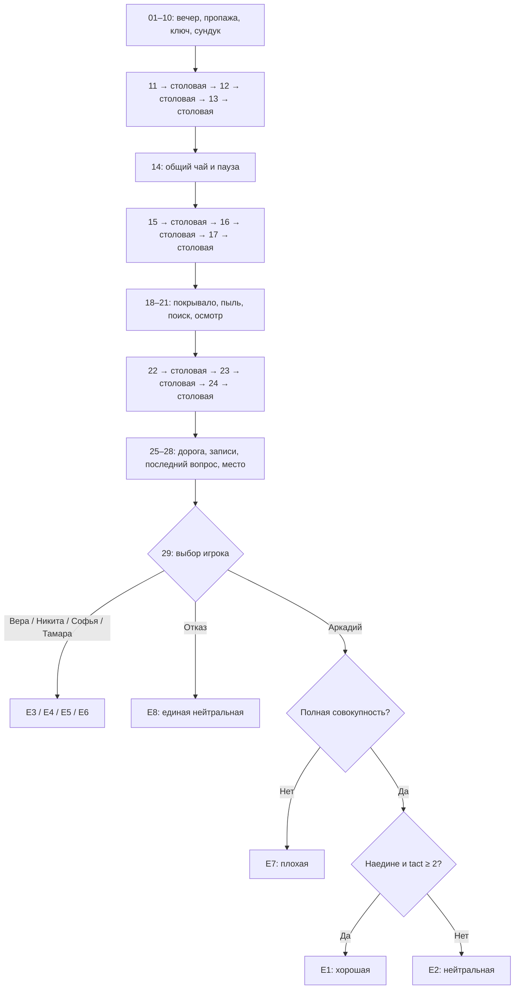

# Авторские приложения

## Реестр событий и последствий

Ветви внутри одной строки — один момент. Смена спрайта, возврат к столу и повторное чтение записи не считаются новыми моментами. Каждый полный маршрут проходит 30 строк, включая одну развязку. Развилки не позволяют выйти в финал раньше 29. «22 / 30 = 73,33%» — результат авторской разметки событий этой версии, а не заключение преподавателя о содержательности каждого выбора.

| № | Событие | Засчитан выбор | Конкретное последствие |
|---|---|---|---|
| 01 | Прибытие | Нет | Знакомство с шестью персонажами и семейным конфликтом |
| 02 | Портрет | Да | История увеличивает тактичность; технический осмотр даёт проверенные габариты для альтернативного поиска |
| 03 | Запрос оценки | Да | Совместно исправленный запрос сохраняет канал сотрудничества даже после неловкой публичной описи ключа; запрет без такого канала может закрыть раннюю фиксацию свёртка |
| 04 | Решение о развеске | Да | План открывает направление к секции; письменный запрет вместо плана позволяет проверить пределы профессионального разрешения Софьи |
| 05 | Передача альбома | Нет | Физический первоисточник будущей проверки, не автоматическое обвинение |
| 06 | Ночной звук | Да | Герой получает либо точную временную опору, либо собственное наблюдение Веры в холле; это разные доступные проверки показаний, не два текста одной реакции |
| 07 | Обнаружение пропажи | Нет | Старт расследования, полиция вызвана за кадром |
| 08 | Организация начала | Да | Сохранение обстановки помогает с габаритом в 11Б; письменные рассказы дают зафиксированное объяснение про альбом |
| 09 | Запасной ключ | Да | Законность получения проверяется или остаётся только версией; меняется сотрудничество Никиты и доступ к раннему свидетельству |
| 10 | Сундук | Да | Совместный осмотр проверяет содержимое и список и открывает личный рассказ Тамары; публичный проверяет только содержимое и закрывает ранний рассказ; отказ оставляет способ хранения непроверенным |
| 11 | Место крепления | Да | Точный габарит для поиска или собственное свидетельство Тамары о хозяине у библиотеки; при сохранённой обстановке габарит доступен в обоих вариантах |
| 12 | Рабочая фотография | Да | Полный источник подтверждает назначение снимка и открывает помощь Софьи; публичное предъявление оставляет это непроверенным и может сорвать точный макет |
| 13 | Записка | Да | Восстановление проверяет содержание; добровольный возврат оставляет его неизвестным, но даёт тактичность и другой доступ к ночному объяснению через Веру |
| 14 | Пауза до дороги | Нет | Фиксирует время и переход ко второму кругу |
| 15 | Переписка или ночь Никиты | Да | Проверяется предмет сделки либо появляется отдельное свидетельство о свёртке и объяснение визита; одно не выдаёт другое автоматически |
| 16 | Реальные материалы | Да | Документально-предметная проверка подготовки перевозки либо габаритный макет, способный открыть альтернативный поиск |
| 17 | Ночной визит Веры | Да | Частичная проверка маршрута либо план библиотечной секции; не полное оправдание |
| 18 | Путь покрывала | Да | Личное свидетельство передачи при сохранённом контакте либо предметный след секции; два разных пути к совокупности против Аркадия |
| 19 | Пиджак | Нет | Показ A8 и границ его доказательной силы, без отдельного балла за пыль |
| 20 | Поиск | Да | Прямое открытие находит портрет; направленный поиск требует подготовки и может не состояться |
| 21 | Происхождение / общий осмотр | Да | Проверка происхождения получает точное отрицание Аркадия; общий осмотр создаёт свидетелей положения места и восстанавливает контакт с Никитой |
| 22 | Альбом / каталог | Да | Проверяется сам экземпляр либо получается прямое объяснение о единственном альбоме; последний вопрос 27 позволяет завершить только выбранную линию |
| 23 | Отдельный свидетель | Да | Фиксируется Никита или Тамара; выбор определяет, какой источник ещё доступен в 24 и какая цепочка полна |
| 24 | Последнее действие | Да | Новая фактическая находка/сохранение положения с первичным ответом владельца либо второй независимый свидетель; неполученный источник не выдаётся |
| 25 | Открытие дороги | Нет | Собирает всех перед передачей материалов, после третьего круга |
| 26 | Сверка записей | Нет | Только ранее полученные сведения; не выдаёт виновного и не дополняет пропущенные проверки |
| 27 | Последний вопрос | Да | Прямо проверяется объяснение о книге либо отрицание передачи; завершение одной цепочки вместо другой |
| 28 | Решение о положении картины | Да | Отказ навязывать развеску сохраняет пространство для добровольного объяснения и даёт тактичность; требование прежнего порядка может оставить только публичную развязку |
| 29 | Финальное действие | Да | Игрок выбирает человека и форму предъявления либо отказ; улики определяют доказанность, не имя выбранного подозреваемого |
| 30 | Одна из восьми развязок | Нет | Показ последствий и завершение истории |

При переводе в DSL не дробить одну строку на несколько «ключевых моментов» ради процента. Если при сокращении текста действие перестанет менять источник, фактический результат или развязку, убрать его из засчитанных выборов и пересчитать минимум полного маршрута. Особенно проверить читательским разбором 06, 21, 24 и 28: они должны оставаться действиями с показанным результатом, а не становиться косметическим разговором. Если ревью сочтёт хотя бы два из нынешних 22 пунктов недостаточно существенными, доля окажется ниже 70%; это нельзя скрыть старым формальным отчётом.

## Все 30 принятых обстоятельств: где появляются и что проверяется

Названия и распределение взяты из принятого `clues_v5/clues.json`. Уточнения ниже не добавляют новых «независимых доказательств». Объяснение со слов всегда отделено от просмотра источника.

| ID | Обстоятельство | Обнаружение → версия → выбранная проверка и её предел |
|---|---|---|
| N1 | Денежный долг | 03: признание Никиты → ему нужна помощь → 15А проверяет сделку, но не отменяет сам долг |
| N2 | Фотографии покупателю | 03: видна отправка → оценка работы → 15А сверяет полный диалог, каталог и ответ покупателя: речь о «Береге», не ночное алиби |
| N3 | Скрытый выход искать дядю | 15: Никита признаёт → искал из-за долга → 23А/24Б фиксируют линию видимости и предел уверенности; точность минуты зависит от источников |
| N4 | Умение снимать рамы | 02Б/11: слова о прежней перевеске → семейная помощь → 11 показывает устройство, подтверждая, что навык не исключительный |
| N5 | Запасной ключ | 09: ключ в сумке → старое поручение → 09А проверяет датированное сообщение и передачу Тамарой; ночью мог использоваться |
| S1 | Знание креплений | 02Б/11: показ устройства → профессия → 11 проверяет способ снятия, но не исполнителя |
| S2 | Упаковка приготовлена | 12/16: готовый комплект → предварительная реставрация → 16А сверяет накладную и неиспользованные материалы, не полное алиби |
| S3 | Реставрация до согласия | 12: заявка → предварительный расчёт → 12А/16А показывают полный ответ мастерской и отсутствие разрешения |
| S4 | Доступ к обороту рамы | 02Б/12: технические сведения → рабочий осмотр → фото и устройство объясняют возможность, не ночное действие |
| S5 | Условия перевозки | 12/16: транспортные поля → расчёт условий → 16А показывает отсутствие даты, заказа и подписи; связан с S3 |
| S6 | Снимок с размерами | 12: рабочее фото → оценка состояния → 12А проверяет исходное вложение, дату и содержание заявки |
| V1 | Спор о портрете | 01/04: открытый конфликт → просьба о совместном решении → 17Б сопоставляет реальный план, не отсутствие личного мотива |
| V2 | Ночной визит | 13/17: признание → оставляла и забирала записку → 17А даёт частичную проверку, не вид ночного портрета глазами героя |
| V3 | Сначала отрицала визит | 17: прямое несовпадение → стыд из-за личного письма → 17А проверяет возможную последовательность, не истинность всех чувств |
| V4 | Порванная записка | 13: фрагменты → извинение → 13А восстанавливает настоящий текст; 13Б оставляет содержание непроверенным |
| V5 | Знание переноса в библиотеку | 04/17 → обсуждавшийся план → 04А/17Б показывают план и место, но знание не доказывает использование ниши |
| V6 | Просила говорить без гостей | 01/04 → семейная неловкость → 17 показывает предмет разговора, не отдельное алиби и не ещё один сильный мотив |
| T1 | Ключи и знание ниши | 10/18 → домашние обязанности → 18Б/20 проверяют устройство и общий доступ, не его исключительность |
| T2 | Ночные перемещения | 11/18 → чашки и бельё → 18А/23Б уточняют порядок; точное полное алиби не выдаётся |
| T3 | Убранная ткань | 18 → бытовая уборка → 18А показывает лоскут в сохранённой корзине, его источник не определён |
| T4 | Умолчала об уборке | 18 → испугалась потери улики → признание не становится независимым подтверждением мотива и связано с T3 |
| T5 | Закрытый сундук | 10 → вещи в мастерскую → 10А/Б реально осматривают пустое от портрета содержимое; только 10А дополнительно сверяет список; 10В не раскрывает его |
| A1 | Ночью у библиотеки | 11Б/15Б/23А → мог брать книгу → 22/27 проверяют заявленную причину, само присутствие нормально для хозяина |
| A2 | Несовпадение про альбом | 08Б/15Б/17/22Б: объяснение → «забыл» → 22А/27Б проверяют тот самый экземпляр и передачу в 22:10; одна книжная цепочка |
| A3 | Покрывало из кабинета | 05/18: место хранения, после находки ткань → доступно домашним → 21А сопоставляет заплату, фотографию интерьера и сам предмет; собственность не равна действию |
| A4 | Личная передача и отрицание | 18А/23Б/24В: свидетельство → Аркадий отрицает в 21А/27А → сопоставление двух конкретных рассказов; одна цепочка, нужен независимый источник |
| A5 | Свёрток в руках | 15Б/23А/24Б: наблюдение Никиты → содержимое неизвестно → проверка линии обзора и личного опознания, без объявления портрета видимым сквозь ткань |
| A6 | Запрет менять развеску | 04 → контроль коллекции → письменная фиксация 04Б/документы 16А показывают распоряжение, но не доказывают, что хозяин сам его нарушил |
| A7 | Избегание решения о месте | 01/04/28 → семейная трудность → настоящий мотив раскрывается только признанием E1/E2; до него эмоция не доказательство |
| A8 | Пыль на пиджаке | 19 → старые книги → показ разных пыльных поверхностей исключает уникальность совпадения; след вспомогательный, не обязательный |

### Почему восемь обстоятельств не означают восемь доказательств

У Аркадия больше обстоятельств, потому что часть относится к маршруту, часть к вещам, часть к противоречиям и мотиву. A1 и A2 связаны одним объяснением визита. A3 и A4 пересекаются по предмету; собственность покрывала не добавляет второго независимого свидетеля передачи. A6–A8 помогают строить версию, но не заменяют её проверку. Два пути — это два способа собрать совокупность, а не ограничение числа доступных улик двумя.

| Группа | Что устанавливает | Чего не устанавливает |
|---|---|---|
| Фактическая находка | Портрет был в библиотечной нише при осмотре | Кто и когда его туда положил |
| Книжное противоречие | Названная причина визита не совпадает с вечерней передачей конкретного экземпляра | Что невозможна забывчивость или иная причина визита |
| Передача и отрицание | Два конкретных рассказа о получении одной вещи несовместимы | Что одной вещью обязательно переносили картину именно руки получателя |
| Свидетельство Никиты | Опознан Аркадий с плоским свёртком у библиотеки | Что Никита видел содержимое |
| Происхождение ткани | Найденная ткань соответствует домашнему покрывалу из кабинета | Что ею мог воспользоваться только Аркадий |
| Пыль, распоряжение, нерешительность | Даёт контекст и направления вопросов | Не является достаточным основанием для обвинения |

## Маршруты для авторского чтения

Обозначения А/Б/В относятся к реальным вариантам сцен, а не к невыписанным репликам. События каждого круга идут в фиксированном порядке, с выписанными возвращениями в столовую. Предыдущие выборы не подменяются названием желаемой концовки.

1. **Хороший финал через книгу:** 02А, 03А, 04А, 06А, 08Б, 09А, 10А; 11А, 12А, 13А; 15Б, 16А, 17А; 18Б, 20А, 21Б; 22А, 23А, 24В; 27Б, 28А; Аркадий наедине. Портрет найден, книга проверена, отдельный свидетель есть, `tact=2`.
2. **Хороший финал без проверенной книги:** 02А, 03Б, 04Б, 06Б, 08А, 09А, 10А; 11Б, 12А, 13Б; 15А, 16А, 17А; 18А, 20А, 21А; 22Б, 23А, 24А; 27А, 28Б; Аркадий наедине. Есть найденный портрет, передача с отрицанием и Никита; `book_checked=false`, `tact=2`.
3. **Хороший финал через направленный поиск:** 02Б, 03А, 04А, 06А, 08Б, 09А, 10А; 11Б, 12А, 13Б; 15Б, 16Б, 17Б; 18Б, 20Б, 21А; 22А, 23А, 24В; 27А, 28А; Аркадий наедине. Поиск в 20Б фактически открывает нишу; `tact=2`.
4. **Нейтральный доказанный:** любой из трёх полных маршрутов, затем Аркадий при всех. Либо полная версия, но 02Б, 13А и 28Б оставили `tact=0`, даже при личном приглашении.
5. **Пять плохих:** один и тот же полный маршрут может закончиться обвинением Веры, Никиты, Софьи или Тамары — фактами игра не отбирает у игрока это решение; неполная версия против Аркадия даёт отдельный E7.
6. **Ненайденный портрет и отказ:** 20Б при отсутствии надёжного направления/габарита, затем 24Б или 24В вместо поиска; в конце отказ. E8 не показывает пропущенную находку и не раскрывает мотив.
7. **Найденный портрет и отказ:** 20А, любые последующие проверки; в конце отказ. Дословно тот же E8.

## Граф для чтения вместе со сценарием

Граф показывает порядок и три точки возврата, но достаточность доказательств определяется условиями, а не одной достижимостью стрелки. Проверка модели не является браузерным прохождением готовой игры.

## Перенос в движок и границы готовности

При подготовке игрового каталога выбрать стабильную версию IlyaBarilo/vn-vertical-engine, записать фактическую версию и перечитать её `docs/specs/spec-story.md`. Для этой литературной работы сверены местные `ENGINE_NOTES.md` и сохранённая спецификация исследованного main `dfa0edb4d2b00b9e4348f61bea61fbaca81a16a7` от 19 октября; это не выбор версии будущей сборки.

Каждый фон объявить в `[bg]`, каждый экспорт сочетания позы, эмоции и кадрирования — отдельным ключом состояния в `[char]`. Игровой текст перенести в `window.STORY_TEXT` внутри `story.js`; постановочные ярлыки преобразовать в `bg`, `hide all`, `show`, реплики и штатные `menu/choice`, `set`, `if`, `goto`. Не вставлять авторские квадратные условия буквально в DSL. Все ресурсы — внутри `assets/` по относительным путям. Системные файлы и `engine/` ради этой логики не менять. Возвраты вести по фиксированному порядку штатными goto. В меню 24 по флагу свидетеля выбирать одну из двух явных версий, исключающих уже выполненный разговор. После реализации провести штатный аудит и браузерное прохождение.

Перед утверждением этой редакции нужны чтение двух авторов и слепое прохождение читателем, не знающим виновника. Проверять: может ли он своими словами связать независимые источники, не слишком ли рано очевиден Аркадий, не воспринимается ли профессиональный осмотр Софьи как более сильное обвинение, видны ли реальные последствия решений. Автоматический перебор не даёт процент угадывания и не доказывает читательский баланс.

Готовы полный литературный текст, постановка, перечень графики и проверяемая модель переходов. Не созданы изображения, звук, игровой `story.js` или сдаваемая папка игры; их создание — последующие этапы.
